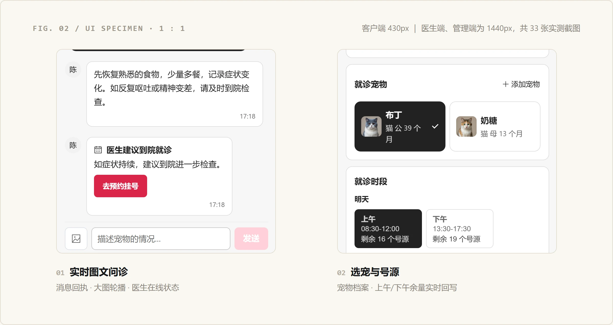

  <picture>
    <source media="(max-width: 600px)" srcset="./assets/readme/hero-mobile.svg">
    
  </picture>

  <a href="mailto:qpalsd@foxmail.com">qpalsd@foxmail.com</a> ·
  广西，中国

## 代表作：宠物医院预约与图文问诊系统

单家宠物医院自用。免费图文问诊承接轻症咨询，医生在会话里推一张「建议到院」卡片，患宠主人点进去就是这位医生的可预约时段与余量；到院后接诊、开病历、诊后评价，都在同一套数据里。

  

- **不超卖** —— 号源扣减走单条条件更新，不额外引入分布式锁；超时未支付自动回收号源。
- **实时** —— 原生 WebSocket：消息落库回执、已读回执、医生在线状态。
- **会话安全** —— 一个拦截器按 `/admin`、`/client` 前缀隔离双端；改密后历史 Token 失效。
- **可验收** —— springdoc 生成 OpenAPI 3 文档；陈氏 ER 图与 ADR 随代码进仓库。

→ **[进仓库看全部截图](https://github.com/chake111/yuzhua-pet-clinic)**

## 其他项目

| 项目 | 它做什么 | 用什么 |
| --- | --- | --- |
| [开源贡献 skill](https://github.com/chake111/agent-skills/tree/main/skills/oss-contribution) | 从筛项目到写 PR 描述的完整贡献流程 | Agent Skill · Markdown |
| [每日投递 skill](https://github.com/chake111/agent-skills/tree/main/skills/boss-daily-apply) | 按简历证据强度匹配投递方向，事后复盘回复率 | Python · Agent Skill |
| [K-Means](https://github.com/chake111/kmeans-from-scratch) | 手写 K-Means 的分配与更新，不调算法库 | Python · NumPy · matplotlib |

## 工具箱

- **语言** — Java · TypeScript · Python · SQL
- **后端** — Spring Boot · MyBatis-Plus · JWT · BCrypt · WebSocket
- **前端** — Vue 3 · Vite · Element Plus
- **数据** — MySQL 8 · Redis
- **AI** — LLM API · Agent Skill
- **工程** — Git · Maven · Docker · OpenAPI · Linux

## 联系

想聊技术、聊机会，或者想知道某个项目怎么做的，邮件最快：[qpalsd@foxmail.com](mailto:qpalsd@foxmail.com)。
