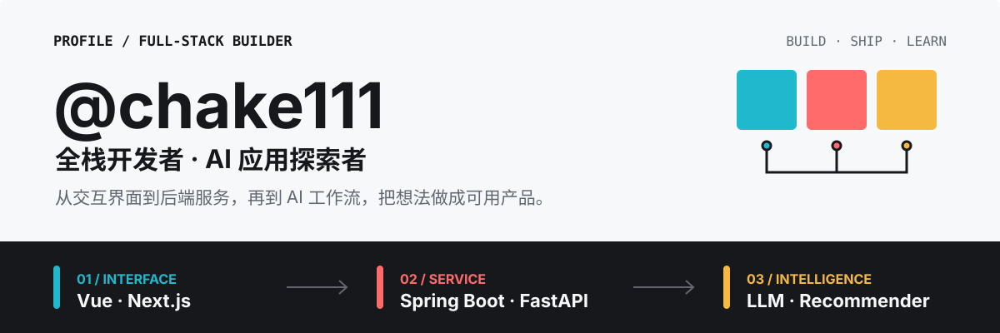

  

  
  
  

---

### 💡 一句话定位

> **专注于高内聚全栈工程与系统架构设计，热衷用可靠代码把真实业务场景转化为高可用产品。**  
> *Full-Stack Developer passionate about clean architecture, high-concurrency data consistency, and user-centered design.*

---

## 🌟 置顶原创代表项目 (Featured Projects)

### 1. 🐾 [宠物医院在线预约与图文问诊系统 (pet-hospital-demo)](https://github.com/chake111/pet-hospital-demo)
**单家宠物医院自用的一体化预约挂号、实时图文问诊与电子病历全流程管理系统（本科毕业设计代表作）**

- **系统完备度**：全套系统架构设计、33 张高保真全端实测截图、RESTful / WebSocket 完整接口规范、陈氏 ER 数据模型与 9 篇架构决策记录（ADR），附带 5.5 万字本科毕业设计论文定稿 PDF。
- **核心工程亮点**：
  - **号源原子级防超卖**：基于数据库行级乐观条件约束更新（`remaining_slots > 0`），无锁化兼顾高吞吐与零超卖；
  - **双向实时在线诊室**：原生 WebSocket 全双工通信，支持患部高清图传、全会话大图轮播、消息送达/已读回执与医生在线状态广播；
  - **线上线下业务连通**：首创问诊室内「建议到院卡片」一键推送，无缝引导线上患宠直通线下排班挂号；
  - **全流程业务闭环**：排班锁号 ➔ 模拟支付 ➔ 候诊 ➔ 医生同屏接诊开立电子病历 ➔ 诊后三维评价全生命周期；
  - **多端安全与会话治理**：双端拦截器路径强隔离，结合 `token_version` 版本号实现修改密码时历史 Token 瞬时注销。
- **技术栈**：`Spring Boot 3.5` · `Vue 3.5` · `Vite 5` · `Element Plus` · `MyBatis-Plus` · `MySQL 8` · `WebSocket` · `JJWT`

---

### 2. 🤖 [AI Tool Picker](https://github.com/chake111/ai-tool-picker)
**“From idea to tools, powered by AI” —— 现代化全栈 AI 生产力工具智能发现、多维对比与决策推荐平台**

- **核心工程亮点**：
  - **场景驱动推荐**：根据用户自然语言需求与业务场景进行意图解析，智能检索并加权排序最适合的 AI 工具矩阵；
  - **全维度深度对比**：支持定价模型、功能标签、适用场景等多指标并排对比，辅助开发者与创作者精准技术选型；
  - **端到端现代化体验**：基于 Next.js App Router 架构与流式交互，支持用户偏好设置、历史行为轨迹追踪与个人收藏集持久化。
- **技术栈**：`Next.js` · `TypeScript` · `React` · `Tailwind CSS` · `PostgreSQL` · `AI Recommendation`

---

### 3. 📊 [K-Means Clustering From Scratch](https://github.com/chake111/kmeans-from-scratch)
**零外部算法库依赖、从零纯数学推导手写实现的经典 K-Means 无监督聚类算法**

- **核心工程亮点**：
  - **底层原理复现**：纯手写欧氏距离计算、动态质心更新与簇内距离平方和（WCSS）最小化目标函数迭代优化；
  - **灵活与可扩展**：支持自定义 $K$ 值与最大迭代轮次，内置收敛判定阈值与异常孤立点防护；
  - **动态可视化**：通过散点分布图与分类着色，高保真还原算法聚类过程与收敛轨迹。
- **技术栈**：`Python` · `NumPy` · `Matplotlib` · `Machine Learning Algorithms`

---

## 🛠️ 技术栈全景 (Tech Stack)

<table>
  <tr>
    <td width="20%"><strong>后端技术</strong></td>
    <td>
      
      
      
      
      
      
      
    </td>
  </tr>
  <tr>
    <td><strong>前端开发</strong></td>
    <td>
      
      
      
      
      
      
      
    </td>
  </tr>
  <tr>
    <td><strong>数据存储</strong></td>
    <td>
      
      
      
    </td>
  </tr>
  <tr>
    <td><strong>工具与工程化</strong></td>
    <td>
      
      
      
      
      
      
    </td>
  </tr>
</table>

---

## 📬 联系我 (Get in Touch)

- ✉️ **Email**: [qpalsd@foxmail.com](mailto:qpalsd@foxmail.com)
- 🐙 **GitHub**: [@chake111](https://github.com/chake111)
- 🌏 **Location**: Guangxi, China
