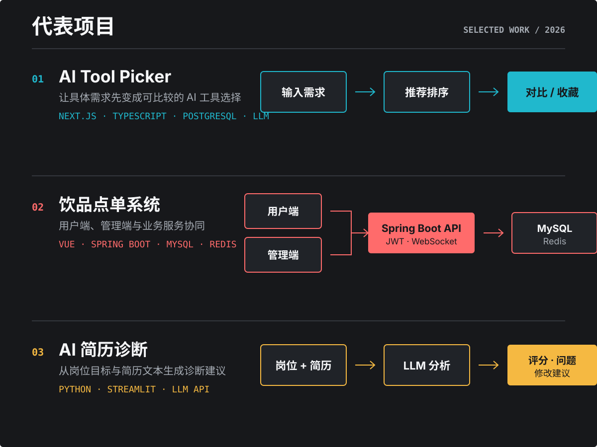

  

  <a href="https://github.com/chake111">GitHub</a> ·
  <a href="https://wakatime.com/@chake111">WakaTime</a>

我关注完整产品链路：从界面与交互出发，连接 API、数据存储和智能能力，持续把想法做成可运行、可验证的项目。

## 代表项目

  

### [AI Tool Picker](https://github.com/chake111/ai-tool-picker)

根据具体任务推荐合适的 AI 工具，提供推荐理由、横向对比、收藏和历史记录。推荐链路包含场景识别、排序实验与离线回归集。

`Next.js` `TypeScript` `PostgreSQL` `Prisma` `NextAuth` `LLM`

### 饮品点单系统

由用户端、管理端和服务端组成的全栈项目。用户端使用 Vue 与 Vant，管理端使用 Vue、Element Plus 与 ECharts，服务端基于 Spring Boot、MyBatis、MySQL、Redis、JWT 和 WebSocket。

[用户端](https://github.com/chake111/drink-user) · [管理端](https://github.com/chake111/drink-admin) · [服务端](https://github.com/chake111/drink-server)

### [AI 简历诊断](https://github.com/chake111/ai-resume-diagnosis-agent)

输入目标岗位与简历文本后，生成评分、核心问题和修改建议；同时处理 API Key 缺失和模型调用失败等异常情况。

`Python` `Streamlit` `OpenAI-compatible API`

## 技术能力

**前端** · Vue 3、TypeScript、Next.js、Vite 
**后端** · Java、Spring Boot、Python、FastAPI 
**数据** · MySQL、PostgreSQL、Redis、Prisma、MyBatis 
**工程** · Git、Docker、Maven、CI、自动化测试

## 开发数据

  <picture>
    <source media="(prefers-color-scheme: dark)" srcset="https://github-readme-stats.vercel.app/api?username=chake111&amp;show_icons=true&amp;include_all_commits=true&amp;hide_border=true&amp;theme=github_dark">
    <source media="(prefers-color-scheme: light)" srcset="https://github-readme-stats.vercel.app/api?username=chake111&amp;show_icons=true&amp;include_all_commits=true&amp;hide_border=true&amp;theme=default">
    
  </picture>

## 链接

- [GitHub · @chake111](https://github.com/chake111)
- [WakaTime · @chake111](https://wakatime.com/@chake111)
