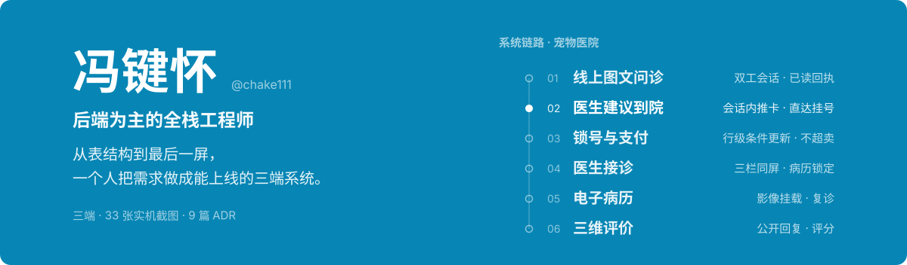

  

  <a href="mailto:qpalsd@foxmail.com">qpalsd@foxmail.com</a> ·
  <a href="https://github.com/chake111">github.com/chake111</a> ·
  广西，中国

  Schema → API → realtime → UI, end to end. Lately: AI workflows that run on their own.

现在主要做两件事：把一套业务从数据模型做到三端界面；把重复的判断写成 AI 能照着跑的 skill。做完的东西尽量留下能验收的痕迹 —— 截图、接口文档、ADR、能跑起来的仓库。

## 代表作：宠物医院预约与图文问诊系统

单家宠物医院自用。线上问诊先把轻症分流，医生在会话里推一张「建议到院」卡片，患宠主人点进去就是这位医生的号源日历；到院后接诊、开病历、诊后评价，都在同一套数据里。

  

- **不超卖** —— `UPDATE ... WHERE remaining_slots > 0` 行级条件更新，不加锁也不超卖；超时未支付由定时任务回收号源。
- **实时** —— 原生 WebSocket：消息送达与已读回执、患部大图轮播、医生在线状态广播。
- **会话安全** —— 双端拦截器路径隔离；`token_version` 让改密即刻注销历史 Token。
- **可验收** —— 9 篇 ADR、OpenAPI 规范与陈氏 ER 图，交付件和代码一起进仓库。

**技术栈** —— `Spring Boot 3.5` · `Vue 3.5` · `MySQL 8` · `MyBatis-Plus` · `WebSocket` · `JJWT`

→ **[进仓库看 33 张实机截图](https://github.com/chake111/pet-hospital-demo)**

## 其他在跑的东西

| 项目 | 它做什么 | 用什么 |
| --- | --- | --- |
| [AI Tool Picker](https://github.com/chake111/ai-tool-picker) | 说一句需求，拿到可对比的工具清单与理由 | Next.js · TypeScript · PostgreSQL · GLM-4-Flash |
| [开源贡献 skill](https://github.com/chake111/oss-contribution-skill) | 从筛项目到写 PR 描述的完整贡献流程 | Agent Skill · Markdown |
| [每日投递 skill](https://github.com/chake111/boss-daily-apply) | 按证据强度配岗位，投递后复盘回复率 | Python · Agent Skill |
| [K-Means](https://github.com/chake111/kmeans-from-scratch) | 不用算法库，手写聚类全流程 | Python · NumPy |

## 工具箱

- **语言** — Java · TypeScript · Python · SQL
- **后端** — Spring Boot · MyBatis-Plus · Spring Security · WebSocket
- **前端** — Vue 3 · Vite · Element Plus · Next.js · Tailwind CSS
- **数据** — MySQL 8 · Redis · PostgreSQL
- **AI** — LLM API · Agent Skill
- **工程** — Git · Maven · Docker · OpenAPI · Linux

## 联系

在做的东西都留了截图和文档，看得上可以直接翻仓库；想聊技术、聊机会，邮件最快。

- **邮箱** — [qpalsd@foxmail.com](mailto:qpalsd@foxmail.com)
- **GitHub** — [@chake111](https://github.com/chake111)
- **位置** — 广西，中国
